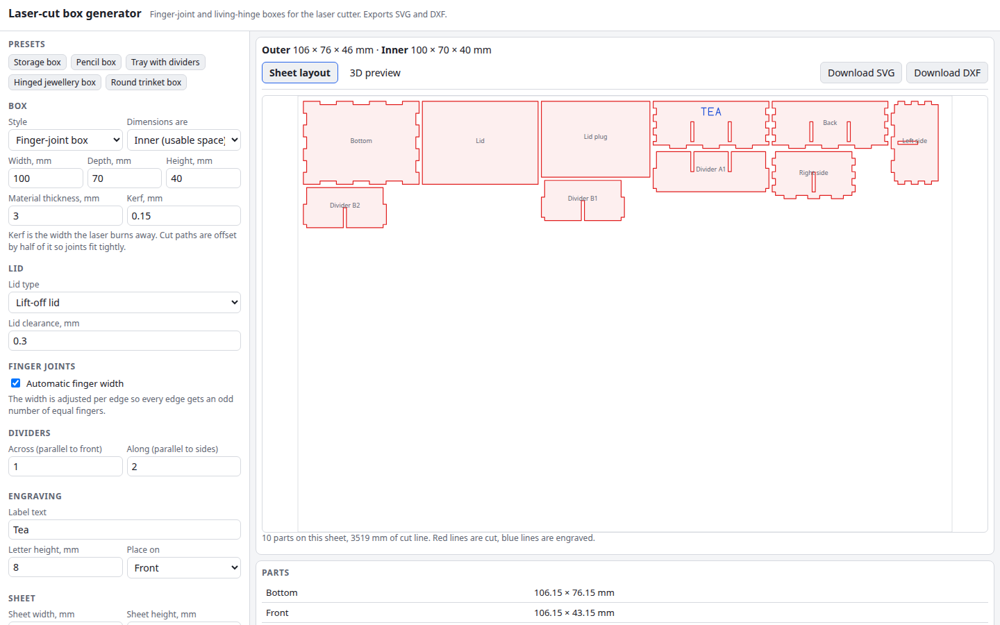

# Laser-cut box generator

Design a box for the laser cutter in your browser. Pick finger-joint (box joint) panels with a closed, open, sliding, hinged or lift-off lid, optional dividers, and kerf compensation that makes the joints fit, or a rounded box whose walls bend through a straight-line living hinge. You get a nested sheet layout, a 3D preview, and SVG and DXF files in millimetres, ready for the cutter.

**Try it: [hermes98761234.github.io/laser-cut-box-generator](https://hermes98761234.github.io/laser-cut-box-generator/)**

[](https://github.com/hermes98761234/laser-cut-box-generator/actions/workflows/deploy.yml)



## Features

- **Finger-joint boxes.** Closed, open-top, or with a lift-off lid (plate plus locating plug), a sliding lid (slotted sides, lowered front), or a hinged lid (back panel, living hinge strip and lid cut as one piece).
- **Inner or outer dimensions**, any material thickness, finger width automatic or manual. Every edge gets an odd number of equal fingers, and the mating edge is the exact complement.
- **Kerf compensation that keeps joints tight.** Outer contours move out by half the kerf and holes and slots move in by half the kerf, so fingers are cut a kerf wider and notches a kerf narrower and finish at nominal size.
- **Dividers** in both directions with tabbed wall slots and half-lap crossings.
- **Rounded box with living-hinge sides.** One wall band with a staggered straight-line lattice in the corners (spacing, slit length and bridge are yours to set), finger tabs into the bottom plate and interlocking seam fingers.
- **Engraved labels** with a built-in single-stroke font (Latin and Ukrainian letters).
- **Live sheet layout**: parts are nested on a sheet of your size, with spacing and margin, 90° turns allowed, and extra sheets when needed.
- **3D folded preview** (three.js, loaded on demand) with an explode slider.
- **Export SVG** (mm units, cut lines red, engraving blue, 0.01 mm hairlines) and **DXF** (R12 ASCII LINE entities, or LWPOLYLINE contours). Both are one file per sheet.
- English and Ukrainian, light, dark or system theme. Your settings are remembered in the browser; nothing is uploaded.

## How it works

Each panel is a rectangle whose edges are lists of segments `(length, recess)`. A finger edge alternates between recess 0 (a finger) and recess t (a notch); its mate uses the opposite pattern. Corners are the intersection of the two neighbouring offset lines, so the same code handles tabs, notches and plain edges. Bottom and top plates own the corner cubes and the vertical edges belong to front and back, so the assembled walls cover the shell exactly once. A unit test samples the folded box on a 0.5 mm grid and checks this for every lid type, with dividers and manual finger widths.

Kerf is applied last, to the finished outlines: a mitred polygon offset of +kerf/2 for contours and -kerf/2 for holes. The part is then moved so its bounding box starts at the origin.

The rounded box is a strip of length `2(W-2r) + 2(D-2r) + 4·(r - t/2)·π/2` (the neutral fibre in the corners). Slits run parallel to the bend axis, one line every `spacing` mm, offset by half a period on every second line.

Layout is a MaxRects packer with the bottom-left rule on the parts' bounding boxes. SVG and DXF are written directly from the placed geometry; the DXF writer has a small parser used by the tests.

Limitations: the sliding lid runs in a slot cut through the side walls, so the slot shows from outside. Living hinge strength depends on the material, so test a strip first. The label font has capitals only, and unknown characters are skipped. DXF `LINE` is the R12-clean choice; `LWPOLYLINE` is an R13+ entity written with an AC1015 header, so use it only if your software wants joined contours.

## Quick start

You need [Node.js](https://nodejs.org/) 22.

```bash
git clone https://github.com/hermes98761234/laser-cut-box-generator.git
cd laser-cut-box-generator
npm install
npm run dev       # http://localhost:5173
npm test          # geometry, export, layout and i18n tests
npm run build     # static site in dist/
```

Geometry lives in `src/lib` as pure functions: `fingers.ts` (edge layout), `box.ts` (finger-joint box), `rounded.ts` (living-hinge box), `layout.ts` (nesting), `exportSvg.ts` and `exportDxf.ts`.

## License

MIT
